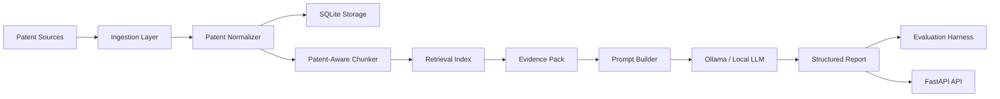

# PatentLLM — LLM-Generated Reports from Patent Data

> **A production-style GenAI pipeline that converts raw patent documents into structured, audience-specific intelligence reports for R&D, sales, marketing, and strategy teams.**

Patent documents are high-value but hard to consume: claims are legalistic, abstracts are compressed, and full descriptions are often too long for fast business review. **PatentLLM** demonstrates how a practical LLM/RAG system can ingest public patent data, retrieve the most relevant patent evidence, and generate structured reports tailored to different business functions.

This project is designed as a **portfolio-grade AI engineering repository**: it is runnable locally, includes realistic system design, exposes a FastAPI service, supports CLI workflows, stores data in SQLite, implements retrieval, provides prompt templates, includes model benchmarking, and ships with evaluation rubrics for faithfulness and usefulness.

---

## What PatentLLM does

PatentLLM turns a patent corpus into useful business reports.

| Business user | Report generated |
|---|---|
| **R&D** | Technical landscape, claim-level mechanisms, novelty signals, design alternatives, whitespace opportunities |
| **Sales** | Competitor activity, product implications, customer-facing value, objection-handling notes |
| **Marketing** | Differentiated messaging, innovation narrative, proof points from patent evidence |
| **Executives / Strategy** | Portfolio-level summary, risks, opportunities, and next-step recommendations |

---

## Why this is a realistic GenAI project

The project demonstrates the core work expected in applied LLM engineering:

- data ingestion from messy public documents
- normalization into a stable internal schema
- retrieval over domain-specific text
- prompt design for multiple business users
- local LLM inference through Ollama
- model fallback behavior
- structured report generation
- evaluation and benchmarking
- FastAPI deployment
- SQL-backed persistence
- CI, tests, Docker, and documentation

---

## Key capabilities

### 1. Patent ingestion

PatentLLM can ingest:

- CSV exports from Google Patents, EPO, USPTO, Lens, or PatentsView-like workflows
- JSON / JSONL patent records
- plain text files
- PDF patent documents
- optional public patent-page URLs through a conservative parser

It normalizes metadata such as:

- patent ID
- title
- abstract
- claims
- description
- assignees
- inventors
- publication date
- filing date
- jurisdiction
- CPC / IPC classification codes
- source URL

### 2. Patent-aware RAG layer

PatentLLM chunks patent documents by semantic patent structure:

- title
- abstract
- claims
- description
- metadata

The default retriever is a lightweight local TF-IDF retriever so the project works immediately. The code is intentionally modular so it can be upgraded to FAISS, Qdrant, pgvector, Sentence Transformers, LlamaIndex, or LangChain retrievers.

### 3. Local LLM generation

PatentLLM supports local model execution through Ollama. You can run models such as:

- Llama 3 / Llama 3.1
- Qwen 2.5
- Mistral
- Gemma

The project also includes a deterministic fallback generator so the full pipeline can be demonstrated even when Ollama is not running.

### 4. Audience-specific report generation

The prompt library uses separate personas and report schemas for:

- R&D technical landscapes
- sales competitive briefs
- marketing innovation briefs
- executive strategy summaries

Each prompt follows evidence-first generation rules:

- use retrieved patent evidence only
- cite patent IDs
- separate evidence from inference
- flag uncertainty
- avoid legal conclusions
- avoid invented assignees, dates, or claim elements

### 5. Evaluation and benchmarking

The evaluation harness measures:

- evidence coverage
- expected term recall
- hallucination risk
- forbidden term detection
- latency
- model fallback behavior
- report structure completeness

You can benchmark multiple local models across the same query and compare latency and output structure.

---

## Architecture



---

## Repository structure

```text
patentllm/
├── src/patentllm/
│   ├── api.py
│   ├── cli.py
│   ├── config.py
│   ├── pipeline.py
│   ├── prompts.py
│   ├── schemas.py
│   ├── storage.py
│   ├── utils.py
│   ├── ingestion/
│   │   ├── parsers.py
│   │   └── patent_sources.py
│   ├── rag/
│   │   ├── chunking.py
│   │   └── vector_store.py
│   ├── llm/
│   │   ├── fallback.py
│   │   └── ollama_client.py
│   ├── reporting/
│   │   └── renderers.py
│   └── evaluation/
│       ├── benchmark.py
│       └── evaluator.py
├── data/sample/
│   ├── sample_patents.jsonl
│   └── labelled_reports.jsonl
├── docs/
│   ├── EVALUATION_RUBRIC.md
│   ├── PROMPTING_GUIDE.md
│   └── RESPONSIBLE_USE.md
├── tests/
├── Dockerfile
├── docker-compose.yml
├── Makefile
└── README.md
```

---

## Quick start

### 1. Clone

```bash
git clone https://github.com/<your-username>/patentllm.git
cd patentllm
```

### 2. Create environment

```bash
python -m venv .venv
source .venv/bin/activate
# Windows:
# .venv\Scripts\activate
```

### 3. Install

```bash
pip install -e ".[dev]"
```

### 4. Run the demo without an LLM

```bash
patentllm demo
```

This loads the sample corpus, builds the retrieval index, and generates a deterministic report.

### 5. Run with Ollama

```bash
ollama pull llama3.1:8b
patentllm report \
  --query "battery thermal management systems for electric vehicles" \
  --audience rd \
  --model llama3.1:8b
```

---

## FastAPI usage

Start the API:

```bash
uvicorn patentllm.api:app --reload
```

Open:

```text
http://localhost:8000/docs
```

Generate a report:

```bash
curl -X POST http://localhost:8000/reports \
  -H "Content-Type: application/json" \
  -d '{
    "query": "battery thermal management systems",
    "audience": "rd",
    "top_k": 5,
    "model": "llama3.1:8b"
  }'
```

---

## Example report output

```markdown
# R&D Technical Landscape: Battery Thermal Management Systems

## Executive summary
The retrieved evidence suggests a strong technical focus on distributed thermal sensing, liquid cooling channel geometry, and predictive control logic for high-density battery packs.

## Key technical mechanisms
1. Multi-zone temperature sensing across battery modules.
2. Dynamic coolant-flow adjustment based on predicted gradients.
3. Safety thresholds connected to charging-current control.

## Patent evidence
- US-2026-000001-A1: independent claim describes a controller configured to alter coolant flow based on module-level temperature signals.
- EP-2026-000004-A1: abstract describes heat-transfer structures embedded between pouch cells.

## R&D implications
The portfolio indicates a defensible direction around software-controlled thermal regulation rather than passive cooling alone.
```

---

## Input schema

```json
{
  "patent_id": "US-2026-000001-A1",
  "title": "Battery pack thermal control system",
  "abstract": "A system for controlling heat transfer in a battery pack...",
  "claims": "1. A battery thermal control system comprising...",
  "description": "The invention relates to battery cooling...",
  "assignees": ["Example Mobility GmbH"],
  "inventors": ["A. Researcher", "B. Engineer"],
  "publication_date": "2026-01-15",
  "jurisdiction": "US",
  "cpc_codes": ["H01M10/613", "B60L58/26"],
  "source_url": "https://patents.google.com/patent/US2026000001A1"
}
```

---

## CLI commands

```bash
patentllm init
patentllm ingest data/sample/sample_patents.jsonl
patentllm list-patents
patentllm index
patentllm report --query "EV battery cooling" --audience rd --model llama3.1:8b
patentllm evaluate --labelled data/sample/labelled_reports.jsonl
patentllm benchmark --models llama3.1:8b qwen2.5:7b mistral:7b --query "EV battery cooling"
```

---

## Evaluation philosophy

PatentLLM evaluates report quality using a hybrid approach:

1. **Retrieval quality**
   - Were the expected patents retrieved?
   - Were claims and abstracts prioritized correctly?

2. **Groundedness**
   - Does the generated report use retrieved evidence?
   - Are patent IDs cited?

3. **Use-case fit**
   - Does the report match R&D, sales, marketing, or executive needs?

4. **Hallucination risk**
   - Does the report invent technical features, assignees, dates, or legal conclusions?

5. **Latency and model fit**
   - Which model gives the best trade-off between quality and speed?

---

## Responsible use

PatentLLM is not a legal-opinion system. It is designed to help analysts summarize and compare public patent information. Generated reports should be reviewed by qualified IP, legal, or technical experts before use in filing, litigation, freedom-to-operate, or investment decisions.

The system includes guardrails to:

- cite patent IDs
- preserve evidence passages
- distinguish evidence from inference
- flag uncertainty
- avoid legal advice
- avoid unsupported novelty or infringement claims

---

## Public references used for design

- EPO Open Patent Services (OPS): REST/XML access to EPO patent data and related datasets.
- USPTO public patent data / export workflows.
- Google Patents public patent pages and exports.
- Ollama local API for running models locally.
- LangChain ChatOllama integration for optional local-LLM orchestration.

---

## Recommended GitHub description

```text
LLM-powered patent intelligence pipeline for generating R&D, sales, marketing, and strategy reports from patent data using RAG, Ollama, FastAPI, SQL storage, and evaluation tooling.
```

## Recommended GitHub topics

```text
llm
rag
patents
patent-analytics
patent-search
ollama
langchain
fastapi
information-extraction
competitive-intelligence
genai
python
```

---

## Roadmap

- [ ] Add FAISS dense retrieval
- [ ] Add EPO OPS OAuth client
- [ ] Add PatentsView adapter
- [ ] Add patent-family clustering
- [ ] Add claim chart generation
- [ ] Add React dashboard
- [ ] Add DOCX/PDF report export
- [ ] Add human-review workflow
- [ ] Add LLM-as-judge evaluation

---

## License

MIT License.
